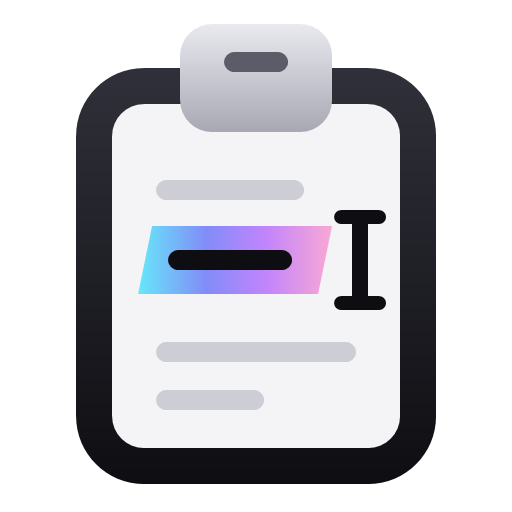

<p align="center">
  
</p>

<h1 align="center">Smart Paste</h1>

<p align="center">Copy a whole block. Paste just the part each form field asks for.</p>

Smart Paste is a free, open-source app for Windows 10 and 11. It sits in the notification area (the system tray).
Copy a block of text, like a resume, an address, or a contact card. Click into a form field and press **Ctrl+V**.
Smart Paste pastes only the value that field wants: the first name, the ZIP code, the email.

## How it works

1. **Copy** a block of text with contact details.
2. **Click** into a form field, in a website or a desktop app.
3. **Press Ctrl+V.** The field gets just its value.

**Jev**, TypeSafe's decision model, decides what gets pasted, every time. It looks at the field (its label, the
text near it, and the section it sits in) and at the values you copied. Then it picks one, and says how sure it is.
When it is not sure, a small picker opens next to the field, and you choose.

Smart Paste asks Jev as soon as you click into a field. So the answer is usually ready before you press Ctrl+V.

## Features

- **Works where you fill in forms.** Websites in your browser and fields in desktop apps.
- **Asks you when unsure.** A picker opens next to the field with the best choices.
- **Every value at hand.** Press **Win+Alt+V** for a picker with everything you copied.
- **Your original paste is one key away.** Smart Paste never touches **Ctrl+Shift+V**.
- **A real paste.** **Ctrl+Z** undoes it, and your clipboard comes back right after.
- **Works without a key.** A built-in list of common field labels, plus the labels it learns on your PC.
- **Learned labels you can see.** A Settings page lists what it learned, and you can remove any of it.
- **Field hints.** A small note next to the field shows what Ctrl+V will paste.
- **Screenshots too, if you want.** It can read text in a copied screenshot with Windows' built-in, offline text
  recognition (OCR). This is off until you turn it on.
- **You stay in control.** Pause it, turn it off, or exclude apps where it should never step in.
- **Calm, modern look.** A quiet, dark-first design with one bright accent: tray flyout, settings, and a welcome
  tour with a practice form. Dark and light.
- **Updates itself.** New versions download in the background and install when you restart it.
- **Private by design.** See [Privacy](#privacy).

## Install

Smart Paste runs on Windows 11, and on Windows 10 version 2004 or later.

1. Open the [latest release](https://github.com/vtikyani/smart-paste/releases/latest).
2. Download the installer for your PC:
   - `SmartPaste.App-win-x64-Setup.exe` for most PCs (Intel or AMD).
   - `SmartPaste.App-win-arm64-Setup.exe` for ARM PCs, like laptops with a Snapdragon chip.
3. Run it. Smart Paste installs for your Windows account only, so it needs no admin rights.
   It needs the .NET 10 Desktop Runtime (Microsoft's free app runtime). If that is missing, the installer offers to
   install it from Microsoft first. Windows asks for admin permission for that one step.

Smart Paste starts right away and shows the welcome tour. It also starts when you sign in to Windows. You can change
that in Settings.

### "Windows protected your PC"

Releases are not code-signed yet. (A code signature is a certificate that proves who built a file.) So Windows
SmartScreen may warn you the first time. Click **More info**, then **Run anyway**. Only do this for files you
downloaded from this project's Releases page.

### Portable version

Prefer no installer? Download `SmartPaste.App-win-x64-Portable.zip` (or the `arm64` one) and unzip it into any
folder you own. Run `Smart Paste.exe` in that folder. It updates itself in place.

The portable version does not install the .NET runtime for you. Get the
[.NET 10 Desktop Runtime](https://dotnet.microsoft.com/download/dotnet/10.0) first. It also has no uninstaller; see
[How do I uninstall it?](#how-do-i-uninstall-it)

## First run

The welcome tour shows you around and lets you try Smart Paste on a practice form. Keys are optional:

- **No key.** Smart Paste matches fields with its built-in list of common labels, plus the labels it learns on your
  PC.
- **An OpenRouter key** (recommended). OpenRouter is a service that runs AI models. One key does two jobs: Claude
  Haiku 5.5 reads your copied block, and Jev decides what each field gets. Get a key at
  [openrouter.ai/keys](https://openrouter.ai/keys).
- **A TypeSafe key** (optional). A direct route to Jev, from [TypeSafe](https://typesafe.ai).

You can add, change, or remove keys later in Settings. Smart Paste keeps them in Windows Credential Manager, never in
a file.

## Keyboard shortcuts

| Keys | What it does |
| --- | --- |
| **Ctrl+V** | While a copied block is ready: pastes the value this field wants. Otherwise: a normal paste. |
| **Ctrl+Shift+V** | Smart Paste never handles it, so the app pastes your clipboard as usual. |
| **Win+Alt+V** | Opens a picker with every value you copied. If nothing is ready, a short note says so. You can change this shortcut in Settings. |
| Your choice | Turns Smart Paste on or off. There is none until you set one in Settings. |

### In a picker

A picker opens next to the field when Jev is unsure, or when you press Win+Alt+V. It never takes the focus from the
app you're typing in.

| Keys | What it does |
| --- | --- |
| **1** to **9** | Pastes that row. |
| **Up** or **Down**, then **Enter** | Pastes the row you moved to. A click on a row works too. |
| Typing | In the Win+Alt+V picker: filters the list. **Backspace**, **Page Up**, **Page Down**, **Home**, and **End** work there too. |
| **Esc** | In a picker that Ctrl+V opened: pastes your clipboard as it is. In the Win+Alt+V picker: just closes it. |
| Anything else | Any other key, or a click outside the picker, closes it without pasting. The key reaches your app as usual. |

A picker also closes by itself after 20 seconds without a key press.

## Privacy

Smart Paste is built to keep what you copy on your PC.

- **No key:** nothing you copy leaves your PC.
- **With a key:** copied text that looks like contact details goes to OpenRouter to be read. Secrets like passwords
  and card numbers are taken out first. While a copied block is ready and you click into a field, Jev gets a
  description of the field, the app's name, and your copied values. Nothing else you copy leaves your PC.
- **No telemetry.** Smart Paste does not track how you use it.
- **Memory only.** The copied block stays in memory and is forgotten after 15 minutes (you can change this).
- **Logs never contain** what you copied, what was pasted, or field labels.
- **Never touches** password fields; fields for card numbers, security codes, bank details, ID numbers, one-time
  codes, or security questions; admin windows; Remote Desktop; Hyper-V; terminals; or password managers.
- **Uninstall removes everything:** keys, settings, learned labels, and logs.

The full details are in [PRIVACY.md](PRIVACY.md).

## Questions and troubleshooting

### Ctrl+V pasted the whole block. Why?

Smart Paste only steps in when all of these are true:

- It is on and not paused.
- The copied text looks like contact details. That means at least two kinds of them: an email address, a phone
  number, a street address, a ZIP or postal code next to its city, or lines labeled like "Name:" or "Phone:". Links
  and dates don't count.
- The block was copied less than 15 minutes ago, and you have not copied anything else since.
- You are pasting into a text box or a drop-down you can type in.
- The app is not one it skips (see below), and you have not excluded it in Settings.

Even then, Jev may decide that none of your values belongs in the field, for example when it asks for an emergency
contact's phone. Then Ctrl+V pastes normally.

The tray icon shows when a copied block is ready.

### A field got the wrong value

Press **Ctrl+Z** to undo it. Then press **Win+Alt+V** and pick the right value. Smart Paste remembers that field's
label on your PC and uses it when Jev can't be reached. If a learned label is wrong, remove it on the **Learned
labels** page in Settings.

### Does it work offline?

Yes. Smart Paste reads the copied block on your PC first, and it matches fields with its built-in label list and the
labels it learned. Jev and the cloud reader add better choices when you are online and have a key.

### Which apps does it skip?

Admin windows (apps you ran as administrator), Remote Desktop, Hyper-V, terminals, password managers, and any app you
exclude in Settings. In those, Ctrl+V works the normal way. Smart Paste also ignores what you copy in Remote Desktop,
Hyper-V, password managers, and apps you exclude. The **Privacy** page in Settings lists every app it skips.

Smart Paste never fills password fields, or fields for card numbers, security codes, bank details, ID numbers,
one-time codes, or security questions.

### Where are the logs?

In `%LOCALAPPDATA%\SmartPaste\logs`, or click **Open log folder** on the **Privacy** page in Settings. The logs record
events and timings, never what you copied. Each time Smart Paste starts, it deletes logs older than 14 days.
Attaching a few lines to a bug report helps a lot.

### Can a script close Smart Paste?

Yes. Run `SmartPaste.exe --exit`. It closes the running copy the normal way, so your clipboard is put back first.
`SmartPaste.exe` is in the `current` folder of the install folder (`%LOCALAPPDATA%\SmartPaste.App\current`), or of
the portable folder.

### How do I uninstall it?

Open Windows **Settings > Apps > Installed apps**, find **Smart Paste**, and choose **Uninstall**. This removes the
app, your saved keys, settings, learned labels, logs, and the start-at-sign-in entry.

For the portable version: in Smart Paste's settings, remove your keys and turn off starting at sign-in. Quit Smart
Paste, then delete its folder and `%LOCALAPPDATA%\SmartPaste`.

## Build from source

You need Windows 10 or 11, the [.NET 10 SDK](https://dotnet.microsoft.com/download/dotnet/10.0), and Git.

```powershell
git clone https://github.com/vtikyani/smart-paste.git
cd smart-paste
dotnet build SmartPaste.slnx
dotnet test SmartPaste.slnx
```

To build the release files (Setup.exe, the portable zip, and update packages) into `artifacts/releases`, run this in
PowerShell 7:

```powershell
./build/publish.ps1
```

[CONTRIBUTING.md](CONTRIBUTING.md) explains how to run Smart Paste from source without touching your own settings.

## How the code is organized

[docs/ARCHITECTURE.md](docs/ARCHITECTURE.md) walks through the projects, the threads, and the copy and paste flows.

## Contributing

Bug reports, ideas, and pull requests are welcome. Start with [CONTRIBUTING.md](CONTRIBUTING.md). To report a
security problem, follow [SECURITY.md](SECURITY.md). Everyone taking part follows the
[Code of Conduct](CODE_OF_CONDUCT.md).

## License

Smart Paste is released under the [MIT License](LICENSE). The open-source parts it is built on, and their licenses,
are listed in [THIRD-PARTY-NOTICES.md](THIRD-PARTY-NOTICES.md).

## Thanks

- [TypeSafe](https://typesafe.ai), for Jev, the model that decides every paste.
- [OpenRouter](https://openrouter.ai), for one key to run both the reader and Jev.
- [WPF UI](https://github.com/lepoco/wpfui), for the controls the app is built from.
- [H.NotifyIcon](https://github.com/HavenDV/H.NotifyIcon), for the tray icon.
- [Velopack](https://github.com/velopack/velopack), for the installer and updates.
- [CommunityToolkit.Mvvm](https://github.com/CommunityToolkit/dotnet), for the app's view models.
